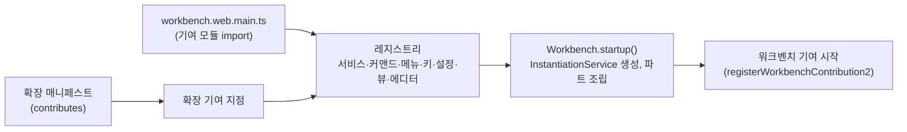

# 유지보수와 확장 가이드

이 문서는 v0.1.0 워크벤치가 유지보수와 확장을 위해 어떻게 지어졌는지, 새 기능이나 확장을 더할 때 어디를 고치는지 설명한다. 각 절은 "무엇이 어떻게 되어 있나, 왜 그런가, 더할 때 어디를 고치나" 순서다. 파일 단위 대응표와 VS Code와의 차이는 [architecture.md](architecture.md), 실행과 사용은 [getting-started.md](getting-started.md), 확장 작성자용 API는 [extension-api.md](extension-api.md)에 있고 여기서는 반복하지 않는다. 경로는 모두 저장소 루트 기준이다.

## 한눈에 보기

기능은 "기존 파일을 고쳐서" 붙이지 않고 "등록해서" 붙인다. 등록 대상은 서비스(싱글턴), 커맨드, 메뉴 항목, 키바인딩, 설정, 뷰 컨테이너와 뷰, 에디터 페인과 직렬화기, 워크벤치 기여, 확장 기여 지점이다. 각 모듈은 import 되는 순간 자신을 레지스트리에 올리고, 진입점 `src/workbench/workbench.web.main.ts`가 모듈을 import 하는 줄이 곧 기능 목록이다. 새 기능은 대개 새 파일 하나와 그 파일을 import 하는 한 줄이다.

## 1. 코드 구조와 레이어 규칙

- 무엇: `src/`는 VS Code의 `src/vs/`와 같은 경로를 따른다. 최상위는 `base`, `platform`, `editor`, `workbench`, `code`이고 이 순서가 의존 방향이다. 아래 레이어만 import 할 수 있다. 각 레이어 안은 `common`(DOM 없음)과 `browser`(DOM 사용)로 나뉘고, 테스트는 대상 옆의 `test/` 폴더에 둔다. 진입점은 `src/code/browser/workbench/workbench.ts`이며 `workbench.web.main.js`를 import 한 뒤 `create(document.body)`를 부른다.
- 왜: 경로를 VS Code와 맞추면 VS Code에서 같은 개념을 찾아 대조하기 쉽다. 방향이 한 쪽으로만 흐르면 낮은 레이어(`base`, `platform`)를 UI 없이 테스트하고 재사용할 수 있고, 순환 의존이 생기지 않는다.
- 무엇이 막나: `src/base/test/common/layering.test.ts`가 `src/` 전체 파일의 import(`import`, `export ... from`, 동적 `import()`, `require`, `import()` 타입)를 TypeScript 컴파일러로 해석해 다음을 검사한다.
  - 윗 레이어 import 금지(예: `base`가 `platform`을 import).
  - `common` 폴더가 `browser` 폴더를 import 금지.
  - `workbench/api/worker`가 `browser` 폴더를 import 금지(확장 호스트는 DOM이 없다).
  - `src/workbench/services/storage/browser/storageService.ts`를 뺀 모든 파일에서 `localStorage`, `sessionStorage`, `indexedDB`라는 이름 사용 금지. 저장은 `IStorageService`로만 한다.
  - 검사기 자체도 심어 둔 위반 예제로 테스트한다.
- 더할 때: 새 파일은 VS Code 경로에 대응하는 위치에 둔다. 대응이 없으면 개념이 속한 레이어를 고르고, DOM이 필요 없으면 `common`에 둔다. 위반은 `npm test`에서 파일과 줄 번호로 나온다.

## 2. 의존성 주입과 서비스

- 무엇: 서비스는 `createDecorator<T>('이름')`으로 만든 식별자(`src/platform/instantiation/common/instantiation.ts`)로 구분한다. 같은 이름의 식별자는 같은 객체다. 생성자 매개변수에 `@IFoo foo: IFoo`로 데코레이터를 달면 `InstantiationService.createInstance`가 그 서비스를 만들어 넣는다. 서비스 인터페이스는 `BrandedService`(`_serviceBrand`)를 확장한다. 구현은 `registerSingleton(IFoo, Foo)`로 모듈 로드 때 전역 목록(`src/platform/instantiation/common/extensions.ts`)에 올린다. 정적 인자가 필요하면 `new SyncDescriptor(Foo, [인자])`를 넘긴다(예: `ConfigurationService`).
- 동작: `InstantiationService` 생성자가 등록된 모든 설명자를 `ServiceCollection`에 넣고, 서비스는 처음 요청될 때 한 번 만들어진다(지연 생성). 만드는 도중 같은 서비스를 다시 요청하면 `Cyclic service dependency: A -> B -> A` 오류를 낸다. `ServicesAccessor`는 `invokeFunction` 안에서만 유효하다.
- 워크벤치가 직접 넣는 서비스: DOM이 필요한 것은 `Workbench.startup()`(`src/workbench/browser/workbench.ts`)가 파트를 만든 뒤 `services.set`으로 넣는다(`IWorkbenchLayoutService`, `IEditorGroupsService`, `IStatusbarService`, `IPaneCompositePartService`).
- 기본(Null) 서비스 패턴: 낮은 레이어가 기본 구현을 먼저 등록하고, 실제 구현이 같은 식별자로 다시 등록해 덮어쓴다. `registerSingleton`은 같은 식별자를 마지막에 등록한 쪽으로 바꾼다. 실제 구현 모듈은 식별자를 정의한 모듈을 import 하므로 기본 구현이 항상 먼저 올라간다. 현재 쌍은 다음과 같다.

| 식별자 | 기본 구현 | 실제 구현 |
| --- | --- | --- |
| `IKeybindingService` | `NullKeybindingService` (`src/platform/keybinding/common/keybinding.ts`) | `WorkbenchKeybindingService` (`src/workbench/services/keybinding/browser/keybindingService.ts`) |
| `IConfigurationService` | `NullConfigurationService` (`src/platform/configuration/common/configuration.ts`) | `ConfigurationService` (`src/workbench/services/configuration/browser/configurationService.ts`) |
| `IExtensionService` | `NullExtensionService` (`src/workbench/services/extensions/common/extensions.ts`) | `ExtensionService` (`src/workbench/services/extensions/browser/extensions.contribution.ts`에서 등록) |

- 왜: 낮은 레이어와 테스트가 실제 구현(브라우저, 스토리지)을 끌어오지 않고도 서비스를 쓸 수 있다. 서비스를 바꿔 끼우는 일은 등록 한 줄이다.
- 주의: 실제 구현이 올라가는 시점은 import 순서가 정한다. 실제 설정 서비스는 `src/workbench/contrib/preferences/browser/preferences.contribution.ts`가 import 해서 올라간다. 이 의존이 숨어 있다는 점은 기술 부채로 남아 있다(10절).
- 더할 때: 인터페이스와 `createDecorator`는 `common`에, 구현은 `browser`에 두고 구현 파일 끝에서 `registerSingleton`을 부른 뒤 `workbench.web.main.ts`에서 닿는 곳(`src/workbench/platformServices.contribution.ts` 같은 서비스 모음이나 기여 파일)에서 import 한다. 테스트에서는 `new InstantiationService(new ServiceCollection([IFoo, fake]))`로 가짜를 넣는다.

## 3. 레지스트리와 기여

모든 레지스트리는 모듈 로드 때 채워지고, 중복 등록은 오류로 거부하는 것이 기본이다.

| 붙이는 것 | 어디에 어떻게 | 위치 |
| --- | --- | --- |
| 커맨드 | `CommandsRegistry`에 id와 핸들러 | `src/platform/commands/common/commands.ts` |
| 액션(커맨드, 메뉴, 키, F1 한 번에) | `registerAction2(class extends Action2)`, 핸들러는 `run(accessor)` | `src/platform/actions/common/actions.ts` |
| 메뉴 항목 | `MenuRegistry.appendMenuItem(MenuId.X, { command, group, order, when })`. `MenuId`는 같은 이름을 두 번 만들면 오류다 | 같은 파일 |
| 키바인딩 | `KeybindingsRegistry`의 규칙 또는 `Action2`의 `keybinding`. `KeybindingWeight`가 우선순위를 정한다 | `src/platform/keybinding/common/keybindingsRegistry.ts` |
| 컨텍스트 키와 `when` | `RawContextKey`로 만들고 `ContextKeyExpr`로 식을 만든다 | `src/platform/contextkey/common/contextkey.ts`, `src/workbench/common/contextkeys.ts` |
| 설정 | `configurationRegistry.registerConfiguration({ id, title, properties })`. 속성은 타입, 기본값, 설명과 선택적인 `enum`, `minimum`, `maximum`을 가진다 | `src/platform/configuration/common/configurationRegistry.ts` |
| 뷰 컨테이너와 뷰 | `viewContainersRegistry.registerViewContainer(...)`, `viewsRegistry.registerViews(...)` | `src/workbench/common/views.ts`, 예: `src/workbench/browser/parts/views/defaultViews.contribution.ts` |
| 에디터 페인 | `Registry.as<IEditorPaneRegistry>(EditorExtensions.EditorPane)!.registerEditorPane(...)` | `src/workbench/browser/editor.ts` |
| 에디터 직렬화기 | `Registry.as<IEditorFactoryRegistry>(EditorExtensions.EditorFactory)!.registerEditorSerializer(typeId, ctor)` | `src/workbench/common/editor.ts` |
| 워크벤치 기여 | `registerWorkbenchContribution2(id, 클래스)`. 클래스는 서비스를 주입받아 워크벤치가 시작될 때 만들어지고, `dispose`가 있으면 워크벤치가 정리한다. 시작 뒤에 등록돼도 바로 시작된다 | `src/workbench/common/contributions.ts` |

`Registry`(`src/platform/registry/common/platform.ts`)는 이름 문자열로 레지스트리 객체를 `add`/`as`로 찾는 작은 저장소다. 같은 이름의 `add`는 오류다.

- 왜: 기능이 기존 파일을 건드리지 않으므로 서로 충돌하지 않고, 기능을 빼려면 import 한 줄을 지우면 된다. 확장이 기여하는 커맨드, 메뉴, 키, 뷰도 같은 레지스트리로 들어가므로 내장 기능과 확장 기능이 같은 경로를 탄다(6절).
- 더할 때: 예를 들어 새 커맨드를 메뉴와 키에 붙이려면 `registerAction2` 파일을 하나 만들고(`src/workbench/browser/actions/layoutActions.ts`가 본보기), `workbench.web.main.ts` 또는 이미 import 되는 `*.contribution.ts`에 import 한 줄을 더한다. 단축키는 플랫폼마다 다르게 해석되므로 [lessons/test-platform-keybindings.md](lessons/test-platform-keybindings.md)를 따른다.

## 4. 레이아웃 확장

- 무엇: 화면은 여섯 파트(`Parts` 열거형: 제목 표시줄, 액티비티 바, 사이드바, 에디터, 패널, 상태 표시줄, `src/workbench/services/layout/browser/layoutService.ts`)이고 `Layout`(`src/workbench/browser/layout.ts`)이 `SerializableGrid`(`src/base/browser/ui/grid/grid.ts`)로 배치한다. 각 파트는 `Part`(`src/workbench/browser/part.ts`)를 상속하고 `src/workbench/browser/parts/` 아래에 있다. 파트 표시 여부와 크기는 `LayoutStateModel`이 스토리지에 저장한다.
- 파트 목록은 레지스트리가 아니라 코드에 고정돼 있다. 새 파트를 더하려면 `Parts`에 항목을 추가하고, `Part` 하위 클래스를 만들고, `Workbench.startup()`에서 만들어 `parts` 배열에 넣고, `Layout.createGridDescriptor()`에 그리드 위치를 적어야 한다. 이것은 의도적이다. 파트가 늘어나는 일은 드물고 그리드 구조가 한 곳에 보이는 편이 낫다.
- 뷰 컨테이너와 뷰는 반대로 레지스트리 기여다. 사이드바와 패널은 `PaneCompositePart`(`src/workbench/browser/parts/paneCompositePart.ts`)를 바탕으로 `viewContainersRegistry`에 등록된 컨테이너를 보여 준다. 새 사이드바 항목이나 패널 탭은 `registerViewContainer`와 `registerViews`만으로 붙는다. 컨테이너를 사이드바와 패널 사이에서 옮기는 일과 위치 저장은 `IViewDescriptorService`(`src/workbench/services/views/browser/viewDescriptorService.ts`)가 맡는다.
- 더할 때: 새 뷰는 `IViewDescriptor`의 `renderBody`를 구현해 등록한다. 상세한 레이아웃 개념은 [vscode-workbench-layout.md](vscode-workbench-layout.md)를 본다.

## 5. 에디터 확장

- 무엇: 에디터는 입력과 페인으로 나뉜다. `EditorInput`(`src/workbench/common/editor/editorInput.ts`)은 무엇이 열려 있는지(내용과 그것을 쥔 자원)를 나타내고, `EditorPane`(`src/workbench/browser/parts/editor/editorPane.ts`)은 그것을 그린다. 페인은 재사용되므로 한 에디터에 속한 상태는 페인이 아니라 입력이나 입력이 만드는 모델에 둔다. 입력의 `typeId`가 레지스트리에서 페인과 직렬화기를 찾는 열쇠다.
- 더할 때, 순서:
  1. `EditorInput` 하위 클래스를 만들고 고유한 `typeId`를 정한다(`WelcomeEditorInput`이 가장 작은 본보기).
  2. `EditorPane` 하위 클래스를 만든다.
  3. `registerEditorPane(EditorPaneDescriptor.create(페인, 페인 id, 이름), [typeId])`로 연결한다(`src/workbench/browser/parts/editor/editor.contribution.ts`).
  4. 새로고침 뒤에도 복원돼야 하면 `IEditorSerializer`(`canSerialize`, `serialize`, `deserialize`)를 만들어 같은 `typeId`로 `registerEditorSerializer` 한다. 직렬화기가 없는 입력은 그룹을 저장할 때 빠진다. 제목 없는 텍스트(`untitledTextEditorHandler.ts`), Welcome(`welcomeEditor.ts`), 설정 JSON(`preferences.contribution.ts`)이 예다.
  5. 입력을 여는 커맨드를 `registerAction2`로 더한다.
- 복원 상태는 `editorPart.ts`가 워크스페이스 스코프 메멘토(`Memento`, `src/workbench/common/memento.ts`)의 `editorpart.state`에 모은다. 제목 없는 텍스트에는 합계 한도(`UNTITLED_TEXT_LIMIT`)가 있다. 새 입력이 큰 데이터를 직렬화한다면 같은 식으로 한도를 둔다.
- 개념과 VS Code 쪽 근거는 [vscode-editor-groups.md](vscode-editor-groups.md)를 본다.

## 6. 확장 시스템

- 무엇: 확장은 `package.json`의 `contributes`로 기능을 선언하고, 코드는 앱과 같은 오리진의 전용 Worker 하나에서 돈다. 워크벤치 쪽(메인 스레드)과 Worker 쪽은 `src/workbench/api/common/extHost.protocol.ts`에 선언한 `Shape` 인터페이스와 `MainContext`/`ExtHostContext` 식별자로만 RPC(`src/workbench/services/extensions/common/rpcProtocol.ts`)를 주고받는다. 건너가는 것은 식별자와 구조화 복제 가능한 데이터뿐이고, 사용자 객체(트리 요소 등)는 Worker에 남는다. 지원되는 매니페스트와 API 목록은 [extension-api.md](extension-api.md)가 정본이다.
- 기여 지점: `ExtensionService`(`src/workbench/services/extensions/browser/extensionService.ts`)가 `ExtensionsRegistry.registerExtensionPoint`로 `commands`, `menus`, `keybindings`, `viewsContainers`, `views` 다섯 개를 만들고, 각 지점의 `setHandler`가 매니페스트 값을 위 3절의 레지스트리에 옮긴다(`menusExtensionPoint.ts`, `keybindingService.ts`, `viewsExtensionPoint.ts`). 값이 틀리면 `ExtensionMessageCollector`로 경고를 남기고 그 항목만 건너뛴다. 확장 기여는 내장 기능과 같은 레지스트리를 쓰므로 키바인딩 우선순위에는 `KeybindingWeight.BuiltinExtension`/`ExternalExtension`이 쓰인다.
- Worker 격리와 한도: Worker 진입점(`src/workbench/api/worker/extensionHostWorkerMain.ts`)은 `postMessage`, `close` 등 통신 슬롯을 지우고, 제어 메시지는 전용 `MessagePort` 뒤에 둔다. Worker 쪽 코드는 DOM에 접근하지 않으며 `tsconfig.extension-worker.json`이 Worker 라이브러리 타입만으로 `src/workbench/api/worker/**`와 `src/vscode-dts/vscode.d.ts`를 검사한다. 읽기 한도는 `extensionResources.ts`에 있다(매니페스트 256 KiB, 진입 파일 5 MiB, 아이콘 256 KiB). 호스트 시작 제한 60초, 응답 확인 주기 2초와 제한 8초는 `webWorkerExtensionHost.ts`에 있다. 확장은 Worker 전역과 실행 자원을 공유하므로 동기 무한 루프를 막지는 못한다(알려진 한계, [extension-api.md](extension-api.md)).
- 새 기여 지점을 더하는 순서:
  1. `src/platform/extensions/common/extensions.ts`의 `IExtensionContributions`에 타입을 더한다.
  2. `ExtensionService`에 `registerExtensionPoint('이름')`을 더하고 `setHandler`에서 레지스트리로 옮기는 함수를 연결한다. 검증은 `contributionValidation.ts`의 도우미를 쓴다.
  3. 제거와 재설치 때 등록이 정리되도록 핸들러가 받는 `registrations`(`DisposableStore`)에 등록 결과를 넣는다.
  4. `docs/extension-api.md`의 기여 지점 표를 갱신한다.
- 새 API(`vscode.*`)를 더하는 순서:
  1. `src/vscode-dts/vscode.d.ts`에 선언한다.
  2. `extHost.protocol.ts`에 두 `Shape` 인터페이스와 식별자를 더한다.
  3. Worker 쪽 구현을 ``src/workbench/api/common/` 아래의 `extHost` 접두 파일`에, 메인 스레드 쪽을 `src/workbench/api/browser/` 아래의 `mainThread` 접두 파일에 만든다.
  4. `extHostExtensionService.ts`에서 프록시를 연결하고 `extHost.api.impl.ts`의 `createApiFactory`가 돌려주는 객체에 노출한다. 확장이 비활성화된 뒤 호출하면 `checkLive`가 오류를 낸다. 메인 스레드 쪽은 `mainThreadExtensionService.ts`에서 `rpc.set(MainContext.…, …)`로 등록한다.
  5. 메인 스레드 구현은 확장이 보낸 값을 신뢰하지 않고 검증하며, 확장 소유 여부(`ownsView` 같은 접근 함수)를 확인한다.
- 개념과 VS Code 쪽 근거는 [vscode-extensions.md](vscode-extensions.md)를 본다.

## 7. 상태와 저장

- 무엇: 모든 영속 상태는 `IStorageService`(`src/platform/storage/common/storage.ts`) 하나를 거친다. 스코프는 `APPLICATION`, `PROFILE`, `WORKSPACE`, 대상은 `USER`, `MACHINE`이다. 브라우저 구현 `BrowserStorageService`(`src/workbench/services/storage/browser/storageService.ts`)는 접두사 `writing-room:storage:` 아래에 키를 쓰고, 키 안에 스코프 번호를 붙인다. 유휴와 `pagehide` 때 `onWillSaveState`가 발생하며, 구성요소는 이 이벤트에 맞춰 저장한다. 객체 상태는 `Memento`(`src/workbench/common/memento.ts`)가 `memento/<id>` 키로 읽고 쓴다.
- 스키마 버전: 접두 키 `writing-room:storage:version`에 `STORAGE_SCHEMA_VERSION`(현재 1)을 적는다. 더 새로운 버전이 적혀 있으면 오류, 옛 버전이면 `registerStorageMigration(fromVersion, (draft) => …)`로 등록한 변환을 한 단계씩 적용한다. 등록된 변환이 없는 단계는 오류다. 지금은 등록된 변환이 없다.
- 새 상태를 저장할 때 지킬 것:
  1. `localStorage` 등을 직접 쓰지 않는다(1절의 레이어링 테스트가 막는다).
  2. 스코프를 고른다. 사용자가 여러 워크스페이스에서 공유할 것은 `PROFILE`, 이 워크스페이스의 레이아웃과 열린 에디터는 `WORKSPACE`다.
  3. 읽을 때 형태를 검증한다. 저장된 값은 이전 버전이나 다른 탭이 쓴 것일 수 있다(`getObject`는 JSON 파싱에 실패하거나 객체가 아니면 기본값을 돌려준다).
  4. 저장된 형태를 호환되지 않게 바꾸면 `STORAGE_SCHEMA_VERSION`을 올리고 `registerStorageMigration`을 같은 변경에 넣는다.
  5. 사용자 선택과 현재 가용성을 한 값에 섞지 않는다([lessons/separate-saved-preference-from-availability.md](lessons/separate-saved-preference-from-availability.md)).
  6. 원격에서 읽은 자원은 읽는 도중에 한도를 적용한다([lessons/bound-remote-resource-streams.md](lessons/bound-remote-resource-streams.md)).
- 저장 개념은 [vscode-state-settings.md](vscode-state-settings.md)를 본다.

## 8. 테스트 전략

- 단위: Vitest(jsdom), `src/**/test/**/*.test.ts`(`vitest.config.ts`). 테스트는 대상 옆 `test/` 폴더에 두고, 서비스는 가짜 서비스로 주입해 검사한다. jsdom에는 레이아웃이 없으므로 크기에 의존하는 검증은 브라우저 테스트에서 한다. 레이어링 테스트도 이 스위트에 속한다.
- 브라우저: Playwright(`test/e2e/*.spec.ts`, `playwright.config.ts`). 개발 서버(`npm run test:e2e`)와 프로덕션 빌드의 프리뷰(`E2E_TARGET=preview`) 양쪽에서 같은 스펙을 돌린다. 빌드에서만 깨지는 문제(워커 번들, 내장 확장 복사)를 잡기 위해서다. 앱과 원격 확장 픽스처 서버(`test/fixtures/serve-extensions.mjs`)를 Playwright가 각각 시작한다. 알려진 병렬 시간 초과 때문에 `--workers=2`로 돌리기를 권장한다([getting-started.md](getting-started.md)).
- 하니스: `test/harness/*.html`, `*.ts`는 개별 서브시스템(그리드, 인스턴스화, 키바인딩, 메뉴, 퀵 인풋, 스토리지, 텍스트 에디터, 확장 호스트)을 워크벤치 없이 띄우는 페이지다. 개발 서버에서만 열리고 빌드에는 들어가지 않는다(`test/e2e/smoke.spec.ts`가 확인한다).
- 원칙:
  - 되돌리면 실패하는 테스트를 쓴다. 고친 코드를 되돌렸을 때 빨개지지 않는 테스트는 무엇도 지키지 못한다.
  - 동작 직후의 상태와 이벤트를 확인한 뒤 다음 동작을 한다([lessons/assert-effects-before-follow-up.md](lessons/assert-effects-before-follow-up.md)).
  - 오래된 비동기 응답을 수락하는지 시험할 때는 성공 응답을 쓴다([lessons/test-stale-successful-validation.md](lessons/test-stale-successful-validation.md)).
  - 트리를 떼었다 붙이는 코드는 모든 노드 이벤트를 막고 끝에서 한 번 맞춘다([lessons/batch-all-node-events.md](lessons/batch-all-node-events.md)).
  - 플랫폼별 단축키는 두 플랫폼 설정으로 모두 검증한다.
- 변경을 끝내기 전에 `npm run typecheck`(세 개의 tsconfig), `npm test`, 필요하면 `npm run test:e2e -- --workers=2`와 프리뷰 스위트를 돌린다.

## 9. VS Code와의 차이를 기록하는 규칙

- 이 저장소는 VS Code를 참고하되 그대로 복사하지 않는다. 의도적으로 달라진 점은 [architecture.md](architecture.md)의 "Deviations from VS Code" 절이 유일한 기록이다. 항목은 해당 영역 아래에 "무엇을 어떻게 했다. VS Code는 이렇다 — 왜 다른가"로 적고, 결정한 이슈 id를 괄호로 붙인다. 사용자가 보는 동작이 바뀌면 같은 PR에서 이 목록과 [getting-started.md](getting-started.md)나 [extension-api.md](extension-api.md)도 고친다.
- 페이지 끝에는 그 내용을 정한 이슈를 `Decided in:` 뒤에 이슈 id를 쓴 한 줄 한 줄로 적는다. VS Code 쪽 근거는 [README.md](README.md)의 고정 커밋을 기준으로 하고 줄 번호 대신 심볼 이름을 적는다.
- 같은 실수를 다시 하지 않도록 리뷰나 작업에서 얻은 규칙은 `docs/lessons/<슬러그>.md`에 `What happened`, `Why`, `Do this instead`와 `Learned in:`으로 적는다. 새 규칙을 만들기 전에 `moai wiki search`로 같은 교훈이 있는지 본다.

## 10. 알려진 기술 부채

v0.1.0을 닫은 뒤에도 backlog에 남은 것의 주제와 대표 이슈다. 전체 목록은 `moai backlog ls`로 본다.

- 서비스와 등록 구조: `InstantiationService`가 만든 싱글턴을 워크벤치 소비자보다 늦게 해제하는 수명 관리가 아직 없다(wr-h1iy). 실제 설정 서비스의 등록이 Preferences 기여 모듈에 숨어 있다(wr-wzwu). `NullConfigurationService`가 레지스트리 기본값을 돌려주지 않아 소비자가 기본값을 반복한다(wr-xkex). `registerAction2`가 중복 id를 거부해서 개발 중 HMR 재등록과 맞지 않는다(wr-byx6).
- 스토리지: 버전 표식 없이 접두 키가 남은 오리진의 처리(wr-a5aw), 쓰기 오류 뒤 메모리 모드 전환 범위(wr-vthy), 뒤로/앞으로 캐시 복귀 때 다른 탭의 스토리지 변경 반영 확인(wr-jg40).
- 에디터: Welcome 시작 판단이 워크벤치 기여가 아니라 워크벤치 본체에 있다(wr-pz63). 여러 그룹에 열린 같은 입력을 그룹마다 직렬화한다(wr-67xb).
- 뷰 컨테이너: 여러 브라우저 탭에서 위치와 순서를 저장할 때 다른 탭의 변경을 보존하는 일(wr-44tg), 패널 복합 파트 서비스의 구독 수명 관리(wr-4449).
- 확장: 활성화 교착을 피하면서 다른 확장의 커맨드 등록을 기다리는 방법(wr-5jqz), 제거 시 `deactivate`가 API를 쓸 수 있게 하는 해제 순서(wr-7987), 오류와 로그에 확장 식별자 대신 설치 세대 키가 남는 문제(wr-m57b), 편집기 제목 도구 모음의 대체 경로 제거(wr-sgqe).
- 빌드와 테스트: `package.json`의 `dompurify` override가 `dist`에 닿지 않는다(wr-q1ee). 브라우저 스펙의 팔레트, 도킹, 확장 설치 도우미가 스펙마다 흩어져 있다(wr-7sbl). 도킹 테스트의 공백과 Firefox 확인(wr-4rbz). Playwright를 병렬로 돌리면 시간 초과가 나는 알려진 문제는 워커 2개로 피한다.

Decided in: wr-510x
